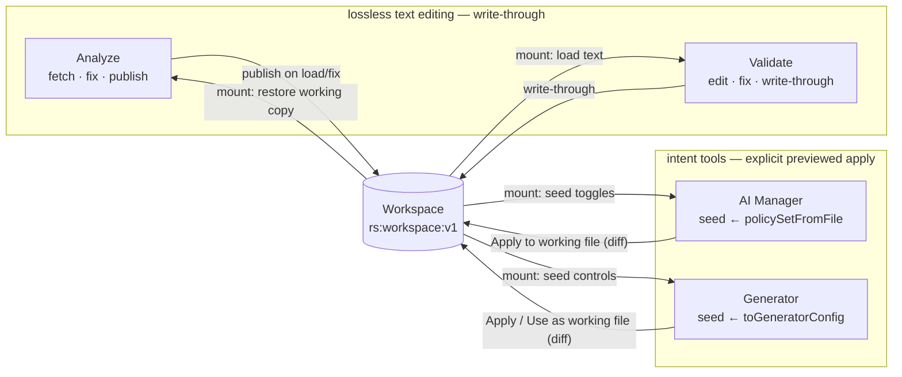

# Shared Workspace — one working robots.txt across the product

> **Phase 17D.** Analyze, Validate, AI Manager, and Generator stop being four
> tools with four copies of the file: they read and write ONE ambient working
> robots.txt (`src/lib/workspace.ts`). No copy/paste, no per-flow plumbing —
> navigation itself carries the file. Local-only by design: localStorage, no
> accounts, no sync, no backend. Companions:
> [`ANALYZER.md`](./ANALYZER.md) (17A–C),
> [`ANALYZER_DASHBOARD_UX_REVIEW.md`](./ANALYZER_DASHBOARD_UX_REVIEW.md).

## The model

```ts
// localStorage "rs:workspace:v1" — the single ACTIVE file
interface Workspace {
  domain?: string; // set when the file was born in the Analyzer
  originalText: string; // the file as it FIRST entered the workspace
  text: string; // the current working robots.txt
  appliedFixes: string[]; // Smart-Fix provenance log (issue codes)
  source: "analyzer" | "validator" | "generator" | "ai-manager"; // last writer
  updatedAt: string; // ISO
}
```

**The text is the single source of truth.** The "analysis result" the brief
lists is a _derived_ field everywhere: every screen recomputes validation,
audit, visibility, and queues from `text` with the same pure engines
(`parseRobots → validateRobots → buildAudit / computeVisibility`). Storing
results in the workspace would denormalize them and they'd be stale after the
first keystroke; recomputing costs ~1 ms for files this size.

**Three stores, three jobs** (all local):

| Store                 | Key                            | Job                                                                                                                                                                  |
| --------------------- | ------------------------------ | -------------------------------------------------------------------------------------------------------------------------------------------------------------------- |
| Workspace (17D)       | `rs:workspace:v1`              | The ONE active file — "what I'm working on now"                                                                                                                      |
| Recent analyses (17C) | `rs:recent-analyses:v1`        | Per-domain ARCHIVE (≤10) for the homepage dashboard + no-refetch restore                                                                                             |
| Handoff (14E)         | `rts:robots-handoff` (session) | Legacy one-shot "take this text to tool X" push; still used for Explainer/Compare/Tester, which are read-only consumers and intentionally do NOT write the workspace |

Per-tab UI state (selection, filters, uncommitted toggle intent) lives in
sessionStorage: `rs:validator-ui`, `rs:analyzer-dimension`, `rs:ai-manager-ui`,
`rs:generator-ui`.

## How each tool participates

| Tool           | READS on mount                                                                                                                                                                              | WRITES                                                                                                                                                              |
| -------------- | ------------------------------------------------------------------------------------------------------------------------------------------------------------------------------------------- | ------------------------------------------------------------------------------------------------------------------------------------------------------------------- |
| **Analyzer**   | Restores its report from the 17C archive; the workspace `text` **outranks** the archived working copy when domains match (it may carry edits from other tools)                              | Publishes the workspace on report load and after every fix (`source: "analyzer"`, `domain` set, fix codes appended to the log)                                      |
| **Validator**  | handoff > workspace > sample. Loading the workspace keeps the session-restored issue selection; a new (handoff) file resets it                                                              | Write-through: every edit, fix, and undo updates `text` immediately (`source: "validator"`); fixes append their codes                                               |
| **AI Manager** | Seeds toggles from the file via `policySetFromFile(parseRobots(text))` — explicit groups → allow/block (Tester verdict on `/`), absent → inherit; `*` disallows/sitemap/crawl-delay carried | **Explicit apply only**: "Apply to working file" commits `impact.text` after an inline diff preview (`source: "ai-manager"`). Toggling alone never touches the file |
| **Generator**  | Seeds controls via `policySetFromFile → toGeneratorConfig`                                                                                                                                  | Same explicit apply ("Use as working file" creates the workspace when starting fresh; `source: "generator"`)                                                        |

Why two write disciplines: the Validator/Analyzer edit the **text itself**
(line-targeted `TextEdit`s — lossless), so write-through is safe. The Manager
and Generator are **regenerative** — their output is rebuilt from intent by the
Generator (the manager never constructs robots.txt strings, per
[`AI_MANAGER.md`](./AI_MANAGER.md)), so comments and rules outside their model
would be silently destroyed by write-through. Hence: explicit, previewed apply.
`policySetFromFile` (`crawler-manager/domain/from-file.ts`, pure + tested) is
the import half; the documented lossiness lives only in the apply step, where
the user sees the exact diff first.

**Live-sync (17E):** after one explicit apply, the working file IS the
generated file — further regeneration loses nothing, so the Manager/Generator
switch to write-through ("Live-syncing — every change here updates the working
file") for the rest of the session. The sync tracks the last text the tool
wrote; if the workspace changes underneath it (edited in the Validator,
re-fetched), the texts no longer match and the tool drops back to explicit
apply. 17D's protection holds exactly where it matters: foreign text is never
replaced without a previewed click.

## Navigation flows (all automatic — the workspace is ambient)



Every flow the brief lists reduces to "navigate; the destination reads the
workspace": Analyze→Validate, Analyze→AI Manager, Analyze→Generator,
Validate→AI Manager, Validate→Generator, AI Manager→Validate (after apply),
Generator→Validate (after apply). Deep-link actions (the Action Queue's "Open
AI Manager"/"Open Generator") need no payload — the destination seeds itself.

## Unsaved-work protection (lightweight, three rules)

1. **Incremental edits can't be lost** — they persist to localStorage on every
   change (closing the tab, Back, or navigating away loses nothing).
2. **Replacement asks first.** Operations that would _replace_ a dirty working
   file (`text !== originalText`) confirm: a new Analyzer fetch
   (`window.confirm`), and a handoff arriving over a dirty workspace in the
   Validator. Declining keeps the current file.
3. **Regeneration is opt-in and previewed.** The Manager/Generator never write
   implicitly; their apply panels state what's replaced and show the exact
   before/after `DiffView` — the apply click _is_ the confirmation.

`WorkspaceBar` (`src/components/workspace-bar.tsx`) renders on Validate / AI
Manager / Generator: `Working file: example.com · last changed in AI Manager ·
3m ago · edited` (provenance from `source`/`updatedAt`), with an expandable
**Recent changes (N)** list of the latest 3 applied fixes (labels via the
Validator's `codeLabel` — receipts, not a history system) and **Discard working
file**, which confirms before resetting every tool (17F.3). The Analyzer's
verdict band carries the inverse cue ("includes changes from Validate") when
the workspace holds another tool's edits.

**Smart deep links (17F.2):** Action-Queue rows link to the exact object —
`/ai-crawlers?focus={crawlerId}` (AI issue ids embed the crawler id) expands
the crawler's group, scrolls the row into view, and marks it briefly;
`/generate?focus=sitemap` lands focused on the sitemap field. **Homepage
(17F.5):** when a workspace exists, `ContinueWorking` shows a resume strip
("Continue working on example.com · Last changed in AI Manager · 3m ago →
Resume") above — and independent of — the recent-analyses archive; clearing
history never touches the active workspace.

## Context preservation

- Validator: filter / dimension / sort / selected issue survive back-forward
  per tab; returning to the workspace file does not reset the selection.
- Analyzer: report restore (17C) + dimension filter per tab.
- Manager / Generator: uncommitted toggle/control state survives back-forward
  per tab, keyed to the workspace text it was based on — if the file changed
  elsewhere meanwhile, stale intent is dropped and the tool re-seeds.
- Scroll: browser-native restoration; panes keep their own scroll state.

## Testing

- `src/lib/workspace.test.ts` — store semantics (origin preservation, fix-log
  accumulation, dirty detection, corrupt storage).
- `crawler-manager/domain/from-file.test.ts` — file→intent inference (explicit
  allow/block, inheritance, baseline paths/sitemap/crawl-delay, case
  insensitivity, empty file).
- `tests-e2e/workspace.spec.ts` — the three journeys end-to-end: Analyze→
  Validate→Manager→Generator with a fix traveling; Validate-paste→Manager
  seed→apply→Validate round-trip; discard returning every tool to defaults.
